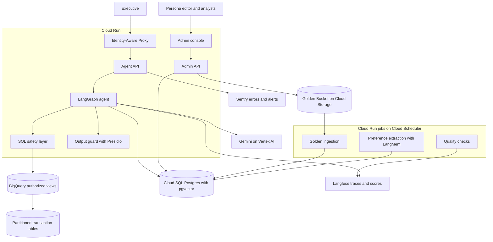
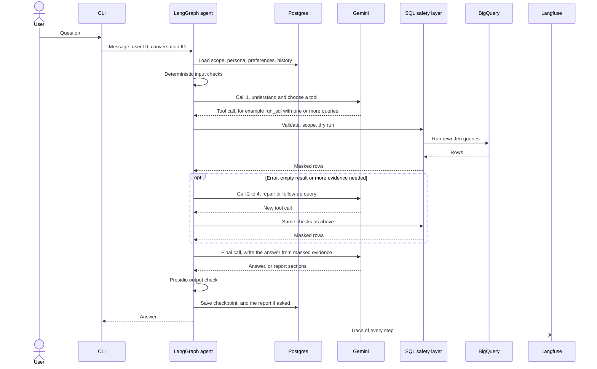
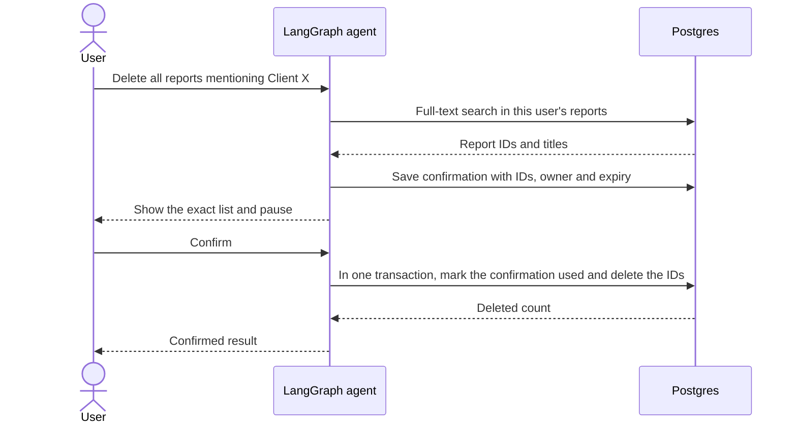
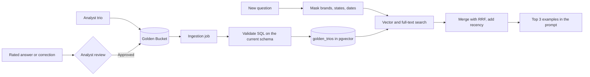

# Architecture

This is the high-level design for the retail data analysis assistant. It covers
the production system and the smaller prototype in this repository. The reasons
behind each choice, with options and sources, are in the
[design proposals](03-design-proposals.md), cited here as P1 to P22.

Facts about the dataset come from the BigQuery table metadata, read on
2026-11-07. Load, cost and model constraints come from the client's answers of
2026-11-08 ([client questions](client-requirements/open-questions.md)).

## Design rules

1. The model proposes and application code decides.
2. Personal data never reaches the model, the traces or the output.
3. Every query runs inside the user's brand scope.
4. A delete needs the user's confirmation of an exact list of reports.
5. Every retry, call and query has a limit, and every limit lives in config with
   the reason for its default.
6. Every model call, tool call and decision has a trace.

## Assumptions

| Topic | Assumption | Source |
|---|---|---|
| Load | About 100 active managers a day, 10 questions and 1 saved report each. Few users at the same time. About 1M new rows a day. | Client |
| Budget | About $1 for each question, configurable | Client |
| Response time | 10 to 30 seconds for a question, 1 to 2 minutes for a report | Client |
| Model calls | 2 to 5 for each question, within Gemini free-tier limits during testing | Client |
| Access | Each manager owns a static list of brands. The CEO sees all brands. | Working default |
| Scoped metrics | Spend and churn use only purchases from the manager's brands | Working default |
| Personal data | Names, email, street address, postal code and coordinates are never exposed | Working default |
| Customer rankings | Results show a salted hash of `user_id`, not the raw ID | Working default |
| Demographics | Age, gender, city, state and country appear only in aggregates | Working default |
| Revenue | Sum of `order_items.sale_price`, excluding `Cancelled` and `Returned` items. The answer states this definition. | Working default |
| Churn | A customer with no purchase in the last 90 days. The answer states it and the user can override it. | Working default |
| Time | UTC and calendar quarters | Working default |
| Reports | Saved only on request, private to the author, including from the CEO. Deletion is permanent. | Working default |

## Production architecture

| Component | Service | Why |
|---|---|---|
| Identity | Identity-Aware Proxy | Authenticates users before a request reaches Cloud Run [1] |
| Agent and admin APIs | Cloud Run | Runs stateless containers that scale with load and to zero [2][3] |
| Scheduled jobs | Cloud Run jobs with Cloud Scheduler | Same container image, no servers to run |
| Orchestration | LangGraph | One node for each safety step and a persistent pause for confirmations [4] |
| Model | Gemini on Vertex AI | Same cloud as the data. The prototype uses an AI Studio key. See P17. |
| Warehouse access | BigQuery authorized views | The agent reads safe views without access to the source tables [5] |
| Application data | Cloud SQL for PostgreSQL with pgvector | One store for conversation state, reports, preferences, personas, trios and audit rows [6]. See P2. |
| Golden source | Cloud Storage | Keeps the analysts' trios as versioned files |
| Output check | Presidio inside the agent container | Detects personal data in the final text. See P4. |
| Agent tracing | Langfuse | Model calls, tool calls, SQL, tokens and user scores, grouped by conversation. See P14. |
| Errors and alerts | Sentry | Crashes, error spikes and email alerts. See P14. |

### Brand scope in production

The SQL safety layer enforces brand scope in both the prototype and production.
Authorized views remove personal columns as a second layer.

I do not use BigQuery row access policies in the first version. They depend on
the identity that runs the query [7], so one shared service account would not
separate managers. Moving to user-delegated credentials would make them a useful
extra layer. Dry runs on row-filtered tables also return 0 bytes [8], so
`maximum_bytes_billed` would become the main cost control.

## Request flow

One analysis question, end to end. Calls to Gemini are numbered, because the
client asked for 2 to 5 calls for each question (P10).

Gemini receives the question, the allowed schema, masked rows, the persona, the
user's preferences and short history. It never receives raw personal fields,
credentials, the hashing salt or other users' brand mappings.

## Prototype agent graph

The prototype is a local CLI. The brief asks it to support safety and PII
masking, the delete confirmation, resilience and observability. The other
requirements are design only, unless P21 lists them as time allows.

The graph below is the code in `src/retail_analyst/agent/graph.py`, node for
node.

| Tool | What it does | Where the safety sits |
|---|---|---|
| `run_sql` | Runs one or more queries and returns rows | SQL guard, byte cap, row cap, per-question query and repair budget |
| `describe_schema` | Lists allowed tables and columns | Built from config, blocked columns never listed |
| `save_report` | Saves a structured report | Output guard on every text field, HTML rendered by code |
| `request_delete` | Holds the user's matching reports for confirmation | Owner filter, stored IDs, expiry, single use |
| `ask_clarification` | Asks one question with 2 to 4 options | At most 2 per question |

The agent node counts model calls. When one call is left, or the time limit is
reached, it calls the model without tools and adds the final-answer
instruction, so the last call always returns an answer. A question that
mentions a report gets the 120-second limit instead of 30.

The first model call does the work of an intent classifier. The tool it chooses
is the intent: `run_sql` for analysis, `describe_schema` for questions about the
data, `ask_clarification` when the meaning changes the result, `request_delete`
for deletes, and a plain answer for everything else. This saves one model call
(P4). Off-topic and attack requests get a refusal from the model, and the SQL
layer blocks anything unsafe whatever the model chooses.

A report is the same loop. The model calls `save_report` with structured
sections, and code renders them to HTML with escaped text and an SVG chart (P6).

| Production | Prototype |
|---|---|
| Identity-Aware Proxy | `--user` flag with demo users in Postgres |
| Cloud Run API | Local CLI |
| Gemini on Vertex AI | Gemini through an AI Studio key, with a Gemini fallback model |
| Authorized views | Scoped subqueries added by the SQL safety layer |
| Cloud SQL | Local Postgres 18 with pgvector |
| Langfuse and Sentry | The same services, switched on by keys in `.env`. Without keys, a local log file. |
| Report viewer | `/open <id>` opens the HTML report in the browser |

## SQL safety layer

The model writes SQL, but BigQuery only receives SQL that passes this code path.
`sqlglot` handles parsing, qualification and rewriting [9][10].

1. Parse one statement with the BigQuery dialect, and reject anything else.
2. Allow only `SELECT` and reject DML, DDL, scripting and external functions.
3. Allow only `orders`, `order_items`, `products` and `users`.
4. Qualify columns and expand `*`, then reject blocked columns by their source.
5. Reject a query that returns a demographic column next to a customer ID.
6. Replace each table with a scoped subquery that exposes allowed columns only.
7. Dry run the rewritten query and check its size.
8. Run it with `maximum_bytes_billed`, a timeout and a row limit [11].

If a step fails, the query does not run. A parse or schema failure goes back to
the model as repair feedback. A scope or PII rejection is logged and never
treated as a bug to repair around.

Column rules come from the real schema:

| Table | Removed from the agent's view | Scoped by |
|---|---|---|
| `users` | `first_name`, `last_name`, `email`, `street_address`, `postal_code`, `latitude`, `longitude`, `user_geom` | Users who bought an allowed brand |
| `products` | None | `brand` |
| `order_items` | None | `product_id` joined to allowed products |
| `orders` | `num_of_item`, because it counts items from other brands | Orders that contain an allowed item |

Scoping happens before aggregation, so a manager's spend and churn cannot include
other brands. The CEO skips the brand filter but keeps every privacy rule.

## Safety layers

| Order | Layer | Type | What it stops |
|---|---|---|---|
| 1 | Input checks | Code | Oversized input, known injection patterns |
| 2 | Agent instructions and tool choice | Model | Off-topic requests. Not a security boundary [12]. |
| 3 | SQL safety layer | Code | PII columns, other brands, writes, cost |
| 4 | Hashed customer IDs | Code, inside the SQL guard | Raw customer IDs. Minimum group size for demographics is design only. |
| 5 | Output guard | Presidio | Personal data that slipped into the text |

The code layers are the security boundary. The model layer only improves the
experience (P4).

## Delete flow

The model can only request a preview. It has no tool that deletes reports. The
delete node runs from the stored report IDs, not from model output or a new
search. LangGraph restarts a node when it resumes [4], so the used confirmation
makes a repeated delete harmless.

Any reply other than an explicit confirmation cancels the action. "Reports we made
in this conversation" uses the same flow, with the search limited to the
conversation ID.

## Storage

All application data sits in one Postgres database (P2).

| Data | Table or store | Retention |
|---|---|---|
| Raw transactions | BigQuery | Owned by the warehouse |
| Conversation state | LangGraph Postgres checkpointer | 90 days |
| Saved reports | `reports`: HTML, plain text, full-text index, owner, conversation | Until the author deletes them |
| Delete confirmations and audit | `delete_requests` | 1 year |
| Demo users and brands | `app_users`, `user_brands` | Static |
| Personas | `personas`, versioned | All versions kept |
| User preferences | LangGraph store, written by LangMem | Until reset |
| Golden trios | `golden_trios`: masked question, embedding, text index, approval | Versioned |
| Traces | Langfuse | 30 days on the free plan [13] |

Traces hold query text, row counts and masked summaries. They do not hold raw rows
or secrets.

## Golden Knowledge

At query time the agent masks the question, runs vector and full-text search on
approved trios, merges the two rankings with reciprocal rank fusion and adds a
small recency weight. The top three go into the prompt as examples. The method
follows DAIL-SQL, OpenSearch-SQL and Generative Agents (P3). Retrieved SQL is only
an example, and any SQL based on it still passes the safety layer.

A trio that fails validation on the current schema stays out of retrieval. The
embedding call runs on a separate embedding model, so it does not count toward the
2 to 5 Gemini calls.

## Learning loop

| Level | Mechanism | Prototype |
|---|---|---|
| User | LangMem saves stated preferences during the turn, and a nightly job extracts the rest from finished conversations (P7) | If time allows |
| System | Corrections become per-user notes and candidate trios. An analyst approves them, and each approved case joins the eval set (P8). | Design only |

The nightly job runs outside the question budget. Only reviewed items reach the
Golden Bucket, so one user cannot teach every user a mistake.

## Persona management

Tone instructions live in the versioned `personas` table and load on each turn.
In production an authorized editor changes the record in the admin console,
previews it and publishes it without a redeploy. In the prototype pgAdmin changes it, and `scripts/set_persona.py` publishes a new version from the command line. Safety rules live in code and the persona cannot override
them (P15).

## Resilience

| Failure | Response | Config key |
|---|---|---|
| SQL parse or schema error | Send the error to the model as a repair, up to 2 for the question | `limits.sql_repairs` |
| Empty result | The tool result tells the model to check the filter values once; the query budget bounds it | `limits.queries` |
| Query too large | Dry run rejects it before it costs anything, and the model is told to narrow it | `bigquery.max_bytes_billed` |
| Slow query | Job timeout, and client retries cut to the same timeout | `bigquery.query_timeout_seconds` |
| Gemini 429, 5xx, timeout | The SDK makes 2 attempts, then the next Gemini model (P10) | `models.attempts_per_model` |
| Gemini keeps failing | Circuit breaker skips that model for 5 minutes | `models.breaker_*` |
| Gemini 400, 401, 403 | No retry and no fallback, a plain message in the CLI | None |
| BigQuery quota or outage | The tool tells the model to stop and say the data service is down; `/open` and `describe_schema` still work | None |
| Budget or time limit reached | The last call has no tools and must answer with what it has | `limits.*` |
| Any other failure in a turn | The CLI logs it and prints a short message; the chat keeps running | None |

The full error table, from Google's documentation, is in P10.

## Configuration

Every tunable value lives in YAML files under `config/`, validated by Pydantic at
start-up. Environment variables override single values. Each default carries a
comment with its reason and source (P20).

| File | Holds | Example default and reason |
|---|---|---|
| `agent/models.yaml` | Models in fallback order, providers on or off, attempts, timeout, breaker | `gemini-3.8-flash`, then `gemini-3.5-flash-lite`. Other providers `enabled: false` at the client's request. |
| `agent/limits.yaml` | Model calls, queries, repairs, clarifications, time and cost per question | 5 model calls, from the client's 2 to 5 guidance |
| `agent/observability.yaml` | Sentry sampling, prompt capture, log file | Prompts off in Sentry, because they can hold anything the user typed |
| `data/bigquery.yaml` | Dataset, tables, byte cap, timeout, row limit | 1 GB cap: the four tables hold about 45 MB |
| `data/schema.yaml` | Columns with descriptions | Read from BigQuery metadata |
| `data/safety.yaml` | Blocked and hashed columns, injection patterns, delete confirmation, output guard | 0.3 output threshold, from measured Presidio scores |
| `prompts/agent.yaml`, `prompts/tools.yaml` | System prompt, GoogleSQL notes, tool descriptions | Editable without code changes |

Golden retrieval settings (top k, weights, half-life) join this list when that
part is built.

## Observability

| Signal | Where | Use |
|---|---|---|
| Trace of each turn | Langfuse | Read the full message and tool sequence of a failed turn |
| User rating | Langfuse score from `/good` and `/bad` | Find bad answers |
| Errors and crashes | Sentry | Email alert on new errors and spikes |
| Agent metrics in the prototype | Langfuse scores and the local JSON log | Outcome, model calls, queries, SQL repairs and seconds for each turn; tokens and latency for each model call come from Langfuse's model spans |
| Agent metrics in production | Langfuse dashboards | Add success rate, refusal rate, empty results, fallback use, bytes scanned and cost per turn |

Detection of unhappy users through scheduled analysis of conversations is design
only (P14).

## Scaling

At the client's load, about 1,000 questions a day with few users at once, one
small Cloud Run instance and a small Cloud SQL instance are enough. State lives in
Postgres, so Cloud Run can add instances without sticky sessions. The growth path
for a sudden rise is in P22: more instances, a connection pool, a report queue,
reserved Gemini capacity and partitioned BigQuery tables.

## Extending the agent

A new capability is a typed tool in the tool registry, its description in
`prompts/`, its own permission check, and a graph route when it needs approval.
Charts, mail and web search all fit this pattern. Sending mail would use the same
confirmation flow as deletion, because it leaves the system and cannot be undone.

## Requirement coverage

| Requirement | Production design | Prototype |
|---|---|---|
| Hybrid intelligence | Golden Knowledge hybrid retrieval | If time allows |
| Safety and PII masking | SQL layer, authorized views, masking, Presidio | Implemented |
| High-stakes oversight | Bound confirmation with LangGraph interrupt | Implemented |
| Continuous improvement | LangMem preferences, reviewed system learning | LangMem if time allows |
| Resilience | Bounded repair, Gemini fallback, degraded mode | Implemented |
| Quality assurance | Ragas eval with a release gate, UX metrics | Eval dataset; minimal Ragas run if time allows |
| Observability | Langfuse and Sentry | Implemented |
| Persona management | Versioned record edited in the admin console | Implemented: versioned table read on every turn, `scripts/set_persona.py` publishes a new tone |

## References

1. [Configure IAP for Cloud Run](https://docs.cloud.google.com/run/docs/securing/identity-aware-proxy-cloud-run)
2. [Host AI agents on Cloud Run](https://docs.cloud.google.com/run/docs/ai-agents)
3. [Cloud Run instance autoscaling](https://docs.cloud.google.com/run/docs/about-instance-autoscaling)
4. [LangGraph interrupts](https://docs.langchain.com/oss/python/langgraph/interrupts)
5. [BigQuery authorized views](https://docs.cloud.google.com/bigquery/docs/authorized-views)
6. [Vector embeddings in Cloud SQL](https://docs.cloud.google.com/sql/docs/postgres/generate-manage-vector-embeddings)
7. [BigQuery row-level security](https://docs.cloud.google.com/bigquery/docs/row-level-security-intro)
8. [Run a query, dry-run behavior](https://docs.cloud.google.com/bigquery/docs/running-queries)
9. [sqlglot lineage](https://sqlglot.com/sqlglot/lineage.html)
10. [sqlglot qualify columns](https://sqlglot.com/sqlglot/optimizer/qualify_columns.html)
11. [Estimate and control BigQuery costs](https://docs.cloud.google.com/bigquery/docs/best-practices-costs)
12. [OWASP LLM Prompt Injection Prevention Cheat Sheet](https://cheatsheetseries.owasp.org/cheatsheets/LLM_Prompt_Injection_Prevention_Cheat_Sheet.html)
13. [Langfuse pricing](https://langfuse.com/pricing)
