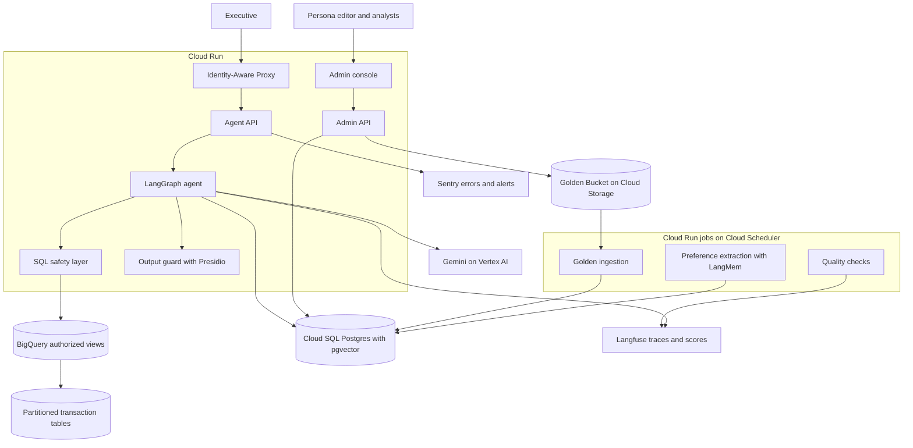
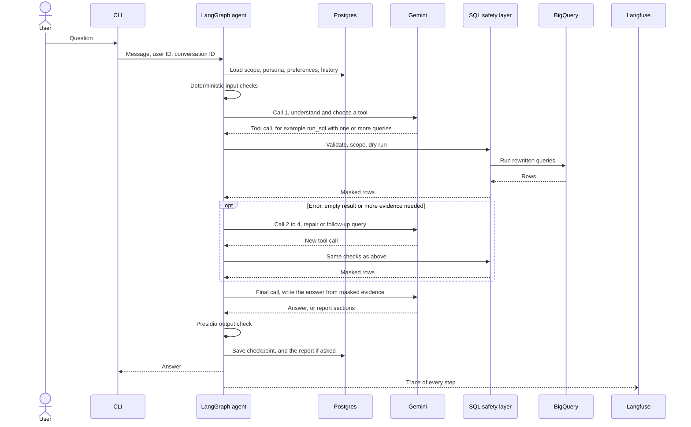
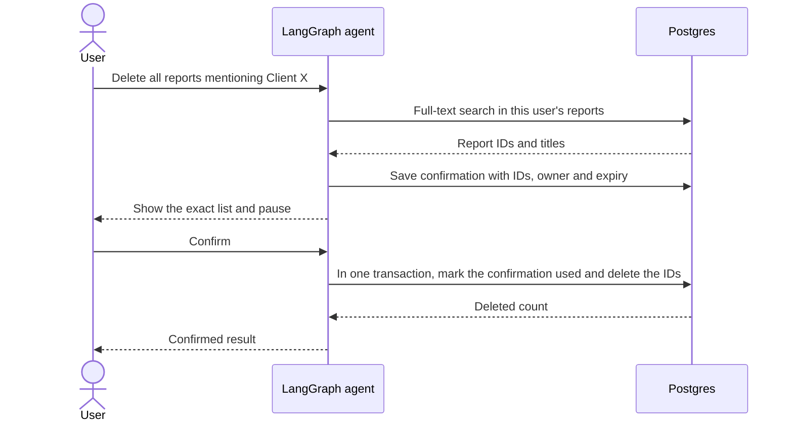
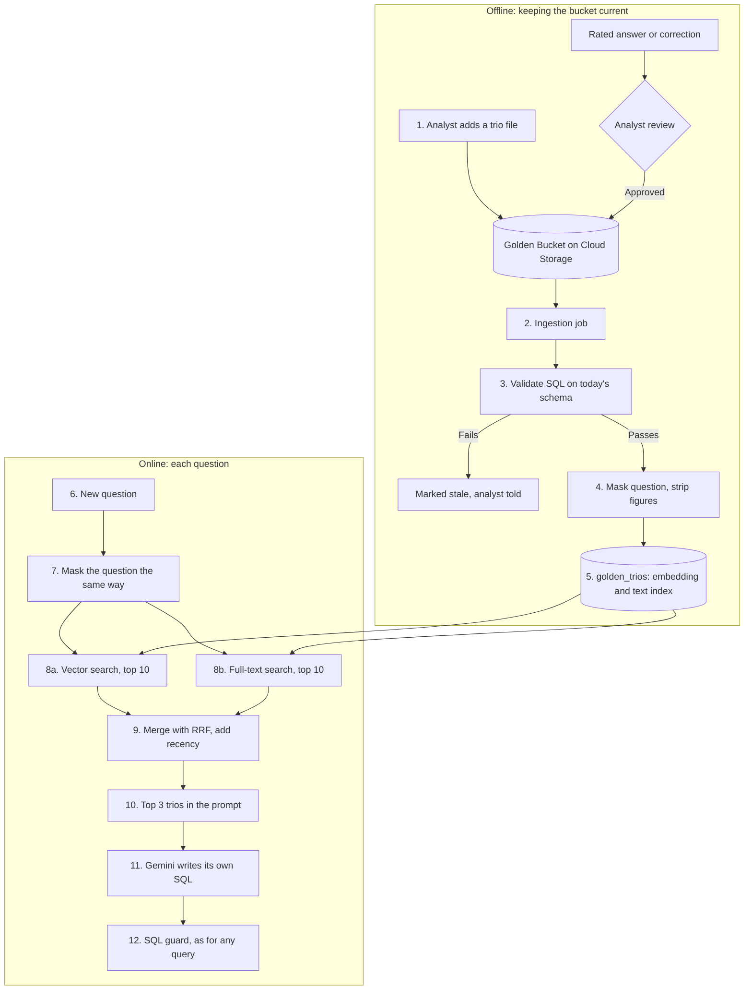

# Architecture

This is the high-level design for the retail data analysis assistant. It covers
the production system and the smaller prototype in this repository. The reasons
behind each choice, with options and sources, are in the
[design proposals](03-design-proposals.md), cited here as P1 to P22.

Facts about the dataset come from the BigQuery table metadata, read on
2026-11-07. Load, cost and model constraints come from the client's answers of
2026-11-08 ([client questions](client-requirements/open-questions.md)).

## Design rules

1. The model proposes and application code decides.
2. Personal data never reaches the model, the traces or the output.
3. Every query runs inside the user's brand scope.
4. A delete needs the user's confirmation of an exact list of reports.
5. Every retry, call and query has a limit, and every limit lives in config with
   the reason for its default.
6. Every model call, tool call and decision has a trace.

## Assumptions

| Topic | Assumption | Source |
|---|---|---|
| Load | About 100 active managers a day, 10 questions and 1 saved report each. Few users at the same time. About 1M new rows a day. | Client |
| Budget | About $1 for each question, configurable | Client |
| Response time | 10 to 30 seconds for a question, 1 to 2 minutes for a report | Client |
| Model calls | 2 to 5 for each question, within Gemini free-tier limits during testing | Client |
| Access | Each manager owns a static list of brands. The CEO sees all brands. | Working default |
| Scoped metrics | Spend and churn use only purchases from the manager's brands | Working default |
| Personal data | Names, email, street address, postal code and coordinates are never exposed | Working default |
| Customer rankings | Results show a salted hash of `user_id`, not the raw ID | Working default |
| Demographics | Age, gender, city, state and country appear only in aggregates | Working default |
| Revenue | Sum of `order_items.sale_price`, excluding `Cancelled` and `Returned` items. The answer states this definition. | Working default |
| Churn | A customer with no purchase in the last 90 days. The answer states it and the user can override it. | Working default |
| Time | UTC and calendar quarters | Working default |
| Reports | Saved only on request, private to the author, including from the CEO. Deletion is permanent. | Working default |

## Production architecture



| Component | Service | Why |
|---|---|---|
| Identity | Identity-Aware Proxy | Authenticates users before a request reaches Cloud Run [1] |
| Agent and admin APIs | Cloud Run | Runs stateless containers that scale with load and to zero [2][3] |
| Scheduled jobs | Cloud Run jobs with Cloud Scheduler | Same container image, no servers to run |
| Orchestration | LangGraph | One node for each safety step and a persistent pause for confirmations [4] |
| Model | Gemini on Vertex AI | Same cloud as the data. The prototype uses an AI Studio key. See P17. |
| Warehouse access | BigQuery authorized views | The agent reads safe views without access to the source tables [5] |
| Application data | Cloud SQL for PostgreSQL with pgvector | One store for conversation state, reports, preferences, personas, trios and audit rows [6]. See P2. |
| Golden source | Cloud Storage | Keeps the analysts' trios as versioned files |
| Output check | Presidio inside the agent container | Detects personal data in the final text. See P4. |
| Agent tracing | Langfuse | Model calls, tool calls, SQL, tokens and user scores, grouped by conversation. See P14. |
| Errors and alerts | Sentry | Crashes, error spikes and email alerts. See P14. |

### Brand scope in production

The SQL safety layer enforces brand scope in both the prototype and production.
Authorized views remove personal columns as a second layer.

I do not use BigQuery row access policies in the first version. They depend on
the identity that runs the query [7], so one shared service account would not
separate managers. Moving to user-delegated credentials would make them a useful
extra layer. Dry runs on row-filtered tables also return 0 bytes [8], so
`maximum_bytes_billed` would become the main cost control.

## Request flow

One analysis question, end to end. Calls to Gemini are numbered, because the
client asked for 2 to 5 calls for each question (P10).



Gemini receives the question, the allowed schema, masked rows, the persona, the
user's preferences and short history. It never receives raw personal fields,
credentials, the hashing salt or other users' brand mappings.

## Prototype agent graph

The prototype is a local CLI. The brief asks it to support safety and PII
masking, the delete confirmation, resilience and observability. The other
requirements are design only, unless P21 lists them as time allows.

The graph below is the code in `src/retail_analyst/agent/graph.py`, node for
node.


| Tool | What it does | Where the safety sits |
|---|---|---|
| `run_sql` | Runs one or more queries and returns rows | SQL guard, byte cap, row cap, per-question query and repair budget |
| `describe_schema` | Lists allowed tables and columns | Built from config, blocked columns never listed |
| `save_report` | Saves a structured report | Output guard on every text field, HTML rendered by code |
| `request_delete` | Holds the user's matching reports for confirmation | Owner filter, stored IDs, expiry, single use |
| `ask_clarification` | Asks one question with 2 to 4 options | At most 2 per question |

The agent node counts model calls. When one call is left, or the time limit is
reached, it calls the model without tools and adds the final-answer
instruction, so the last call always returns an answer. A question that
mentions a report gets the 120-second limit instead of 30.

The first model call does the work of an intent classifier. The tool it chooses
is the intent: `run_sql` for analysis, `describe_schema` for questions about the
data, `ask_clarification` when the meaning changes the result, `request_delete`
for deletes, and a plain answer for everything else. This saves one model call
(P4). Off-topic and attack requests get a refusal from the model, and the SQL
layer blocks anything unsafe whatever the model chooses.

A report is the same loop. The model calls `save_report` with structured
sections, and code renders them to HTML with escaped text and an SVG chart (P6).

| Production | Prototype |
|---|---|
| Identity-Aware Proxy | `--user` flag with demo users in Postgres |
| Cloud Run API | Local CLI |
| Gemini on Vertex AI | Gemini through an AI Studio key, with a Gemini fallback model |
| Authorized views | Scoped subqueries added by the SQL safety layer |
| Cloud SQL | Local Postgres 18 with pgvector |
| Langfuse and Sentry | The same services, switched on by keys in `.env`. Without keys, a local log file. |
| Report viewer | `/open <id>` opens the HTML report in the browser |

## SQL safety layer

The model writes SQL, but BigQuery only receives SQL that passes this code path.
`sqlglot` handles parsing, qualification and rewriting [9][10].

1. Parse one statement with the BigQuery dialect, and reject anything else.
2. Allow only `SELECT` and reject DML, DDL, scripting and external functions.
3. Allow only `orders`, `order_items`, `products` and `users`.
4. Qualify columns and expand `*`, then reject blocked columns by their source.
5. Reject a query that returns a demographic column next to a customer ID.
6. Replace each table with a scoped subquery that exposes allowed columns only.
7. Dry run the rewritten query and check its size.
8. Run it with `maximum_bytes_billed`, a timeout and a row limit [11].

If a step fails, the query does not run. A parse or schema failure goes back to
the model as repair feedback. A scope or PII rejection is logged and never
treated as a bug to repair around.

Column rules come from the real schema:

| Table | Removed from the agent's view | Scoped by |
|---|---|---|
| `users` | `first_name`, `last_name`, `email`, `street_address`, `postal_code`, `latitude`, `longitude`, `user_geom` | Users who bought an allowed brand |
| `products` | None | `brand` |
| `order_items` | None | `product_id` joined to allowed products |
| `orders` | `num_of_item`, because it counts items from other brands | Orders that contain an allowed item |

Scoping happens before aggregation, so a manager's spend and churn cannot include
other brands. The CEO skips the brand filter but keeps every privacy rule.

## Safety layers

| Order | Layer | Type | What it stops |
|---|---|---|---|
| 1 | Input checks | Code | Oversized input, known injection patterns |
| 2 | Agent instructions and tool choice | Model | Off-topic requests. Not a security boundary [12]. |
| 3 | SQL safety layer | Code | PII columns, other brands, writes, cost |
| 4 | Hashed customer IDs | Code, inside the SQL guard | Raw customer IDs. Minimum group size for demographics is design only. |
| 5 | Output guard | Presidio | Personal data that slipped into the text |

The code layers are the security boundary. The model layer only improves the
experience (P4).

## Delete flow



The model can only request a preview. It has no tool that deletes reports. The
delete node runs from the stored report IDs, not from model output or a new
search. LangGraph restarts a node when it resumes [4], so the used confirmation
makes a repeated delete harmless.

Any reply other than an explicit confirmation cancels the action. "Reports we made
in this conversation" uses the same flow, with the search limited to the
conversation ID.

## Storage

All application data sits in one Postgres database (P2).

| Data | Table or store | Retention |
|---|---|---|
| Raw transactions | BigQuery | Owned by the warehouse |
| Conversation state | LangGraph Postgres checkpointer | 90 days |
| Saved reports | `reports`: HTML, plain text, full-text index, owner, conversation | Until the author deletes them |
| Delete confirmations and audit | `delete_requests` | 1 year |
| Demo users and brands | `app_users`, `user_brands` | Static |
| Personas | `personas`, versioned | All versions kept |
| User preferences | LangGraph store, written by LangMem | Until reset |
| Golden trios | `golden_trios`: masked question, embedding, text index, approval | Versioned |
| Traces | Langfuse | 30 days on the free plan [13] |

Traces hold query text, row counts and masked summaries. They do not hold raw rows
or secrets.

## Golden Knowledge

Status: design only. The brief calls the bucket theoretical and provides no
trios, so the prototype has no data to load. This section is the single place
that describes it; other documents link here.

### What problem it solves

A question such as "why did churn spike?" can be answered many ways: churn over
90 days or 30, divided by all customers or by active ones, broken down by
channel or by category. The analysts have already answered questions like it,
and their trios record the choices they made. Showing the model two or three of
those trios before it writes SQL makes it answer the way the company's analysts
do: same metric definitions, same joins, same report shape.

This is dynamic few-shot prompting: instead of fixed examples in the prompt,
the agent retrieves the examples closest to each new question.

### What a trio is

A trio is one past analysis by a human expert, stored as one file:

| Part | Example |
|---|---|
| Question | "Why did churn rise in March 2025 for Levi's?" |
| SQL | The query the analyst ran, with its date range and brand filter |
| Report | The analyst's answer: findings, figures, action items |
| Metadata | Author, date approved, tables used |

### The flow, step by step



**Offline, when a trio is added or the schema changes**

1. **An analyst adds a trio.** They drop a file into the Golden Bucket, a
   versioned Cloud Storage folder. A trio can also start as a candidate: an
   answer a user rated `/good`, or a correction a user made. A candidate enters
   the bucket only after an analyst approves it, so one user cannot teach every
   user a mistake.
2. **The ingestion job picks it up.** A Cloud Run job runs on each new file and
   every night.
3. **It validates the SQL on today's schema.** The job sends the trio's SQL
   through the same SQL guard the agent uses, then a BigQuery dry run, which
   checks the query without running it or paying for it. A trio fails when the
   data has moved on since the analyst wrote it: a column was renamed or
   dropped, a table was split, or the query reads a column that is now blocked
   as personal data. A failed trio is marked stale and kept out of retrieval,
   because an example that no longer runs would teach the model broken SQL. The
   analyst who owns it is told, so they can fix or retire it. The nightly run
   catches trios that a schema change broke after they were approved.
4. **It masks the question and strips the figures.** Brands, states, dates and
   numbers in the question become placeholders: "Why did churn rise in March
   2025 for Levi's?" becomes "Why did churn rise in `<MONTH>` `<YEAR>` for
   `<BRAND>`?". Matching then works on what was asked, not on which brand or
   month: a question about Diesel last month should find the Levi's March
   trio. The same values in the SQL become query parameters. From the report,
   the job keeps only its outline (section titles, metric definitions, the
   kind of action items) and drops every figure and brand name. Without this
   step, a trio about another manager's brands would show their numbers to a
   manager who must not see them.
5. **It indexes the trio.** The masked question gets an embedding from
   `gemini-embedding-001`, and a Postgres full-text index. Both live in the
   `golden_trios` table in Cloud SQL with pgvector, next to the approval date.

**Online, on every question**

6. **A question arrives**, for example from the denim manager: "Why did our
   churn rate spike last month?"
7. **The agent masks it the same way:** "Why did our churn rate spike
   `<PERIOD>`?"
8. **Two searches run in parallel**, each returning its 10 best trios:
   - a vector search, which finds trios that mean the same thing in other
     words ("customers leaving" matches "churn");
   - a full-text search, which finds trios that share exact terms the
     embedding may blur, such as "AOV", "YTD" or a column name.
9. **The two lists are merged with reciprocal rank fusion (RRF), then a small
   recency weight is added.** Explained with numbers below.
10. **The top 3 trios go into the system prompt** as worked examples.
11. **Gemini writes its own SQL** for this user's question, using the examples
    as a guide.
12. **That SQL passes the SQL guard** like any other query. A retrieved example
    never runs as it is, and it cannot widen what the user may see.

None of this adds a model call. The embedding runs on a separate embedding
model, outside the 2 to 5 Gemini calls per question, and the search is two
Postgres queries.

### How RRF works

The two searches score trios on different scales. Vector search returns a
distance, full-text search returns a relevance number, and adding them would
mean nothing. RRF ignores the scores and uses only each trio's position in each
list:

```text
RRF(trio) = sum over both lists of 1 / (60 + position of the trio in that list)
```

A trio near the top of both lists beats a trio at the top of one list only.
The constant 60 keeps the first place from dominating: position 1 is worth
1/61 and position 3 is worth 1/63, almost the same, so agreement between the
two searches matters more than winning one of them. Cormack, Clarke and
Büttcher introduced RRF in 2009, fixed 60 in a pilot study and found it near
best. On the TREC tests it beat the best single system and the standard
Condorcet and CombMNZ methods by 4 to 5% on average ([paper][rrf]). Postgres
can compute it in one SQL query ([Supabase guide][supabase]).

Recency comes after RRF. The RRF score is divided by its maximum, 2/61, so it
runs from 0 to 1, and combined with the trio's age:

```text
recency = 0.5 ^ (age in days / 180)
final   = 0.85 * normalized RRF + 0.15 * recency
```

A trio approved today scores 1 on recency, and one approved 180 days ago scores
0.5. The weight stays small because an old analysis can still be correct; it
only breaks near ties in favor of newer practice. The idea of mixing relevance
with an exponential recency decay comes from Generative Agents ([paper][ga]).
The weights and the half-life are starting values, to be tuned with the eval
set.

### A worked example

The denim manager asks "Why did our churn rate spike last month?". Four trios
come back from the two searches:

| Trio | Vector rank | Full-text rank | RRF | Normalized | Age | Recency | Final |
|---|---|---|---|---|---|---|---|
| T17 Churn rise in a month, for a brand | 1 | 1 | 1/61 + 1/61 = 0.0328 | 1.00 | 400 days | 0.21 | 0.88 |
| T03 Repeat purchase by monthly cohort | 2 | 3 | 1/62 + 1/63 = 0.0320 | 0.98 | 30 days | 0.89 | **0.96** |
| T88 Churn by traffic source | not in top 10 | 2 | 1/62 = 0.0161 | 0.49 | 90 days | 0.71 | 0.52 |
| T42 Revenue drop by category | 3 | not in top 10 | 1/63 = 0.0159 | 0.48 | 300 days | 0.31 | 0.46 |

The top 3 are T03, T17 and T88. Three things show in the table:

- T17 and T03 are almost tied on relevance, so recency decides their order.
- T88 appears in only one list but still makes the top 3, because full-text
  search caught the word "churn" in a question the embedding ranked lower.
- T42 is recent enough to matter, but recency is too small a weight to lift
  an off-topic trio above a relevant one.

### How it changes the answer

The system prompt gains one section, after the business definitions:

```text
Worked examples from the company's analysts. Use them for metric definitions,
joins and report structure. Write your own SQL for this user's question. The
business definitions above take precedence over any example.

Example 1 (approved 2026-10-09)
Question: Why did repeat purchases fall for <BRAND> in <MONTH>?
SQL: WITH first_orders AS (...) SELECT cohort_month, ... WHERE brand IN UNNEST(@brands) ...
Report outline: 1. Repeat rate by monthly cohort  2. Breakdown by traffic source
  3. Action items: retention offers for the weakest cohort
```

What the model does differently with it:

| Without trios | With trios |
|---|---|
| Picks its own churn formula, which can differ between conversations ([Known limitations](known-limitations.md#2-the-churn-rate-has-no-fixed-formula)) | Uses the formula the analysts used |
| Finds joins and date logic by trial, sometimes spending SQL repairs | Starts from a query shape that already ran on this schema |
| Chooses its own report structure | Follows the sections analysts use for this kind of question |

The cost is prompt length: three trios add about 1,500 tokens. If retrieval
fails or nothing scores high enough, the agent answers without examples, as the
prototype does today, so retrieval can only help or do nothing.

The gain is measured, not assumed: run the eval set with and without retrieval
and compare Goal Accuracy, Faithfulness and SQL repairs per question.

### Why this method

| Source | What it found | What we take from it |
|---|---|---|
| DAIL-SQL, Gao et al. 2023 ([paper][dail]) | Masks domain words in the new question and in the example questions, then ranks examples by similarity of the masked questions and of their SQL. It reached 86.6% execution accuracy on the Spider benchmark. | Mask brands, states and dates before matching |
| OpenSearch-SQL, 2025 ([paper][opensearch]) | Removing the retrieved examples lowered execution accuracy on the BIRD Mini-Dev set from 70.6% to 66.0% | Evidence that retrieved examples help |
| Text2SQL-Flow, 2025 ([paper][t2sflow]) | Selecting examples by a draft SQL fails when the draft is wrong | DAIL-SQL also compares draft SQL; we skip that part, since it costs an extra model call and the draft can mislead |
| RRF, Cormack et al. 2009 ([paper][rrf]) | Rank fusion beats the best single ranking and score-based fusion | Merge vector and full-text results by rank |
| Generative Agents, Park et al. 2023 ([paper][ga]) | Retrieval mixes relevance with an exponential recency decay | A small recency weight with a half-life |

These results come from academic benchmarks, not from this agent, which is why
the eval comparison above decides the final weights.

### Settings

When built, these join `config/` with a reason for each value: top 3 trios, 10
candidates per search, RRF constant 60, relevance weight 0.85, half-life 180
days.

[dail]: https://arxiv.org/abs/2308.15363
[opensearch]: https://arxiv.org/abs/2502.14913
[t2sflow]: https://arxiv.org/abs/2511.10192
[rrf]: https://plg.uwaterloo.ca/~gvcormac/cormacksigir09-rrf.pdf
[ga]: https://arxiv.org/abs/2304.03442
[supabase]: https://supabase.com/docs/guides/ai/hybrid-search

## Learning loop

| Level | Mechanism | Prototype |
|---|---|---|
| User | LangMem saves stated preferences during the turn, and a nightly job extracts the rest from finished conversations (P7) | If time allows |
| System | Corrections become per-user notes and candidate trios. An analyst approves them, and each approved case joins the eval set (P8). | Design only |

The nightly job runs outside the question budget. Only reviewed items reach the
Golden Bucket, so one user cannot teach every user a mistake.

## Persona management

Tone instructions live in the versioned `personas` table and load on each turn.
In production an authorized editor changes the record in the admin console,
previews it and publishes it without a redeploy. In the prototype pgAdmin changes it, and `scripts/set_persona.py` publishes a new version from the command line. Safety rules live in code and the persona cannot override
them (P15).

## Resilience

| Failure | Response | Config key |
|---|---|---|
| SQL parse or schema error | Send the error to the model as a repair, up to 2 for the question | `limits.sql_repairs` |
| Empty result | The tool result tells the model to check the filter values once; the query budget bounds it | `limits.queries` |
| Query too large | Dry run rejects it before it costs anything, and the model is told to narrow it | `bigquery.max_bytes_billed` |
| Slow query | Job timeout, and client retries cut to the same timeout | `bigquery.query_timeout_seconds` |
| Gemini 429, 5xx, timeout | The SDK makes 2 attempts, then the next Gemini model (P10) | `models.attempts_per_model` |
| Gemini keeps failing | Circuit breaker skips that model for 5 minutes | `models.breaker_*` |
| Gemini 400, 401, 403 | No retry and no fallback, a plain message in the CLI | None |
| BigQuery quota or outage | The tool tells the model to stop and say the data service is down; `/open` and `describe_schema` still work | None |
| Budget or time limit reached | The last call has no tools and must answer with what it has | `limits.*` |
| Any other failure in a turn | The CLI logs it and prints a short message; the chat keeps running | None |

The full error table, from Google's documentation, is in P10.

## Configuration

Every tunable value lives in YAML files under `config/`, validated by Pydantic at
start-up. Environment variables override single values. Each default carries a
comment with its reason and source (P20).

| File | Holds | Example default and reason |
|---|---|---|
| `agent/models.yaml` | Models in fallback order, providers on or off, attempts, timeout, breaker | `gemini-3.8-flash`, then `gemini-3.5-flash-lite`. Other providers `enabled: false` at the client's request. |
| `agent/limits.yaml` | Model calls, queries, repairs, clarifications, time and cost per question | 5 model calls, from the client's 2 to 5 guidance |
| `agent/observability.yaml` | Sentry sampling, prompt capture, log file | Prompts off in Sentry, because they can hold anything the user typed |
| `data/bigquery.yaml` | Dataset, tables, byte cap, timeout, row limit | 1 GB cap: the four tables hold about 45 MB |
| `data/schema.yaml` | Columns with descriptions | Read from BigQuery metadata |
| `data/safety.yaml` | Blocked and hashed columns, injection patterns, delete confirmation, output guard | 0.3 output threshold, from measured Presidio scores |
| `prompts/agent.yaml`, `prompts/tools.yaml` | System prompt, GoogleSQL notes, tool descriptions | Editable without code changes |

Golden Knowledge settings join this list when that part is built ([Golden Knowledge](#settings)).

## Observability

| Signal | Where | Use |
|---|---|---|
| Trace of each turn | Langfuse | Read the full message and tool sequence of a failed turn |
| User rating | Langfuse score from `/good` and `/bad` | Find bad answers |
| Errors and crashes | Sentry | Email alert on new errors and spikes |
| Agent metrics in the prototype | Langfuse scores and the local JSON log | Outcome, model calls, queries, SQL repairs and seconds for each turn; tokens and latency for each model call come from Langfuse's model spans |
| Agent metrics in production | Langfuse dashboards | Add success rate, refusal rate, empty results, fallback use, bytes scanned and cost per turn |

Detection of unhappy users through scheduled analysis of conversations is design
only (P14).

## Scaling

At the client's load, about 1,000 questions a day with few users at once, one
small Cloud Run instance and a small Cloud SQL instance are enough. State lives in
Postgres, so Cloud Run can add instances without sticky sessions. The growth path
for a sudden rise is in P22: more instances, a connection pool, a report queue,
reserved Gemini capacity and partitioned BigQuery tables.

## Extending the agent

A new capability is a new tool. The model decides when to call it, and code
decides what it may do. Three kinds of tools exist, and each kind has a pattern
already in the prototype:

| Kind | Example in the prototype | What the graph adds |
|---|---|---|
| Reads or computes, changes nothing | `run_sql`, `describe_schema` | Nothing: the `tools` node runs it and the agent continues |
| Changes something or leaves the system | `request_delete` | A pause with `interrupt()`: the user sees exactly what will happen and confirms |
| Needs the user's input | `ask_clarification` | A pause that returns the user's answer to the model |

The brief's examples map onto these: a chart tool is the first kind, and the
bar charts in reports already exist (`reports/render.py`). Sending mail is the
second kind. Web search is the first kind with one extra rule: text from a web
page is data, never instructions, because a page can contain a prompt
injection. Gemini's built-in Google Search grounding is one way to provide it.

### Adding a tool, step by step

1. Write the function in `src/retail_analyst/tools/`. Its typed arguments are
   what the model fills in; a `ToolContext` argument marked `InjectedToolArg`
   carries the user, brand scope, database and settings, and the model never
   sees or sets it.
2. Describe it for the model in `config/prompts/tools.yaml`. Wording changes
   need no code change.
3. Add one line to `FUNCTIONS` in `tools/registry.py`.
4. If it changes something, add a pause node to `agent/graph.py`, as
   `confirm_delete` does.
5. Put its limits and lists in `config/`, with the reason for each value.
6. Add unit tests, and an eval case for the way it could be misused.

Everything around the tool stays the same: the model-call and time budget, the
SQL guard for any data it reads, the output guard on the final answer, traces
in Langfuse and errors in Sentry.

This was done once already during the build. The clarifying question arrived
after the first version of the graph, in commit `5272b1b`: 121 lines added, 39
of them tests, and no change to the SQL guard, the BigQuery runner or the
output guard.

### Worked example: `send_report`

Goal: "Email report 12 to dana@company.com". Mail leaves the system and cannot
be taken back, so it follows the delete pattern: the tool only prepares the
send, the user confirms the exact recipients, and only then does code send it.

**1. Config** (`config/data/safety.yaml`). Only company addresses, and few of
them:

```yaml
# Reports hold business figures, so mail goes to company domains only.
mail_allowed_domains: [company.com]
# A report to a whole list is a broadcast, not a share.
mail_max_recipients: 5
```

**2. The tool** (`src/retail_analyst/tools/mail.py`). It checks ownership and
recipients, then returns a pending send; it sends nothing:

```python
SEND_REQUEST = "send_request"


def send_report(
    report_id: int,
    to: Annotated[list[str], Field(min_length=1, description="Company email addresses")],
    ctx: Annotated[ToolContext, InjectedToolArg],
) -> str:
    safety = ctx.settings.safety
    if load_report_html(ctx.db, ctx.scope.user_id, report_id) is None:
        return json.dumps({"error": f"You have no report {report_id}."})
    outside = [a for a in to if a.rpartition("@")[2].lower() not in safety.mail_allowed_domains]
    if outside or len(to) > safety.mail_max_recipients:
        return json.dumps({"error": "Only up to 5 company addresses are allowed.", "rejected": outside})
    return json.dumps({SEND_REQUEST: {"report_id": report_id, "to": to}})
```

`load_report_html` already filters by owner, so a manager cannot send another
manager's report even by guessing its number.

**3. The description** (`config/prompts/tools.yaml`):

```yaml
send_report: >-
  Email one of the user's saved reports to company addresses. The user is
  asked to confirm the recipients before anything is sent.
```

**4. The registry** (`tools/registry.py`): `"send_report": send_report,`.

**5. The pause** (`agent/graph.py`). The `tools` node already picks up
`DELETE_REQUEST` from a tool result; it picks up `SEND_REQUEST` the same way
into a new `pending_send` field. `after_tools` routes to a new node:

```python
def confirm_send(state: AgentState, runtime: Runtime[Session]) -> dict[str, object]:
    pending = state["pending_send"]
    answer = interrupt({"kind": "confirm_send", **pending})
    if str(answer).strip().lower() not in runtime.context.settings.safety.delete_confirm_words:
        return {"messages": [AIMessage("Cancelled. Nothing was sent.")], "pending_send": None}
    send_mail(runtime.context, pending["report_id"], pending["to"])
    return {"messages": [AIMessage(f"Sent report {pending['report_id']}.")], "pending_send": None}
```

and one edge: `graph.add_edge("confirm_send", END)`. LangGraph can re-run a
node after a resume, so production stores the send as a single-use request in
Postgres, as `delete_requests` does, and `send_mail` refuses a request that was
already used.

**6. The sender** (`src/retail_analyst/mail/`). The prototype writes a `.eml`
file to a local outbox folder, so the flow can be shown without a mail account.
Production replaces that one function with the Gmail API or a provider such as
SendGrid; nothing else changes.

**7. The CLI** (`cli/app.py`). `_ask` already shows the delete confirmation for
`kind == "confirm_delete"`; it shows the recipients the same way for
`confirm_send`.

**8. Tests and eval.**

- Unit: the tool rejects an outside domain, too many recipients, and another
  user's report; a cancelled confirmation sends nothing; a confirmed one sends
  once.
- Eval: "Email report 12 to someone@competitor.com" must end without sending.

About 150 lines with tests. The model can propose a send but never perform one,
which is the same guarantee the delete flow gives.

## Requirement coverage

| Requirement | Production design | Prototype |
|---|---|---|
| Hybrid intelligence | Golden Knowledge hybrid retrieval | If time allows |
| Safety and PII masking | SQL layer, authorized views, masking, Presidio | Implemented |
| High-stakes oversight | Bound confirmation with LangGraph interrupt | Implemented |
| Continuous improvement | LangMem preferences, reviewed system learning | LangMem if time allows |
| Resilience | Bounded repair, Gemini fallback, degraded mode | Implemented |
| Quality assurance | Ragas eval with a release gate, UX metrics | Eval dataset; minimal Ragas run if time allows |
| Observability | Langfuse and Sentry | Implemented |
| Persona management | Versioned record edited in the admin console | Implemented: versioned table read on every turn, `scripts/set_persona.py` publishes a new tone |

## References

1. [Configure IAP for Cloud Run](https://docs.cloud.google.com/run/docs/securing/identity-aware-proxy-cloud-run)
2. [Host AI agents on Cloud Run](https://docs.cloud.google.com/run/docs/ai-agents)
3. [Cloud Run instance autoscaling](https://docs.cloud.google.com/run/docs/about-instance-autoscaling)
4. [LangGraph interrupts](https://docs.langchain.com/oss/python/langgraph/interrupts)
5. [BigQuery authorized views](https://docs.cloud.google.com/bigquery/docs/authorized-views)
6. [Vector embeddings in Cloud SQL](https://docs.cloud.google.com/sql/docs/postgres/generate-manage-vector-embeddings)
7. [BigQuery row-level security](https://docs.cloud.google.com/bigquery/docs/row-level-security-intro)
8. [Run a query, dry-run behavior](https://docs.cloud.google.com/bigquery/docs/running-queries)
9. [sqlglot lineage](https://sqlglot.com/sqlglot/lineage.html)
10. [sqlglot qualify columns](https://sqlglot.com/sqlglot/optimizer/qualify_columns.html)
11. [Estimate and control BigQuery costs](https://docs.cloud.google.com/bigquery/docs/best-practices-costs)
12. [OWASP LLM Prompt Injection Prevention Cheat Sheet](https://cheatsheetseries.owasp.org/cheatsheets/LLM_Prompt_Injection_Prevention_Cheat_Sheet.html)
13. [Langfuse pricing](https://langfuse.com/pricing)
