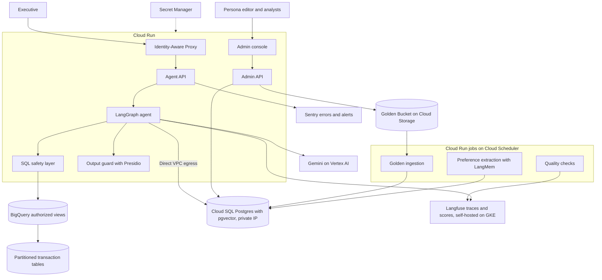
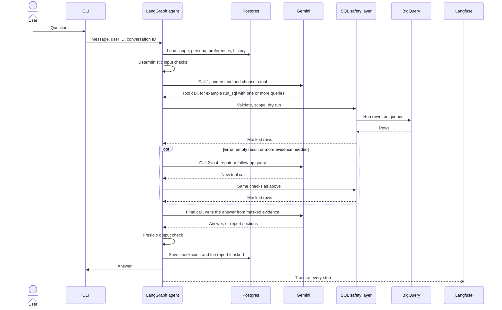
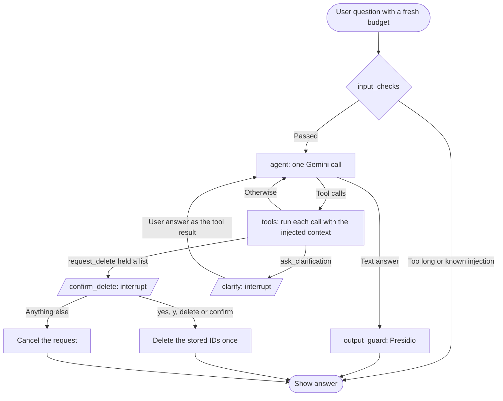

# Architecture

This is the high-level design (deliverable 1): the building blocks, the cloud
services, compute and storage, and how a question flows through them. It covers
the production system and the smaller prototype in this repository.

How each requirement is solved, step by step, is in the
[technical explanation](04-technical-explanation.md). The options behind each
choice, with sources, are in [design decisions](03-design-decisions.md), cited
as P1 to P22.

| Diagram | Section |
|---|---|
| Production components and services | [Production architecture](#production-architecture) |
| One question, end to end | [Request flow](#request-flow) |
| The prototype's agent graph, node for node | [Prototype agent graph](#prototype-agent-graph) |
| Delete confirmation | [Technical explanation: high-stakes oversight](04-technical-explanation.md#high-stakes-oversight) |
| Golden Knowledge, offline and online | [Technical explanation: hybrid intelligence](04-technical-explanation.md#hybrid-intelligence) |

Facts about the dataset come from the BigQuery table metadata, read on
2026-11-07. Load, cost and model constraints come from the client's answers of
2026-11-08 ([client questions](client-requirements/open-questions.md)).

## Design rules

1. The model proposes and application code decides.
2. Personal data never reaches the model, the traces or the output.
3. Every query runs inside the user's brand scope.
4. A delete needs the user's confirmation of an exact list of reports.
5. Every retry, call and query has a limit, and every limit lives in config with
   the reason for its default.
6. Every model call, tool call and decision has a trace.

## Assumptions

| Topic | Assumption | Source |
|---|---|---|
| Load | About 100 active managers a day, 10 questions and 1 saved report each. Few users at the same time. About 1M new rows a day. | Client |
| Budget | About $1 for each question, configurable | Client |
| Response time | 10 to 30 seconds for a question, 1 to 2 minutes for a report | Client |
| Model calls | 2 to 5 for each question, within Gemini free-tier limits during testing | Client |
| Access | Each manager owns a static list of brands. The CEO sees all brands. | Working default |
| Scoped metrics | Spend and churn use only purchases from the manager's brands | Working default |
| Personal data | Names, email, street address, postal code and coordinates are never exposed | Working default |
| Customer rankings | Results show a salted hash of `user_id`, not the raw ID | Working default |
| Demographics | Age, gender, city, state and country appear only in aggregates | Working default |
| Revenue | Sum of `order_items.sale_price`, excluding `Cancelled` and `Returned` items. The answer states this definition. | Working default |
| Churn | A customer with no purchase in the last 90 days. The answer states it and the user can override it. | Working default |
| Time | UTC and calendar quarters | Working default |
| Reports | Saved only on request, private to the author, including from the CEO. Deletion is permanent. | Working default |

## Production architecture

| Component | Service | Why |
|---|---|---|
| Identity | Identity-Aware Proxy | Authenticates users before a request reaches Cloud Run [1] |
| Agent and admin APIs | Cloud Run | Runs stateless containers that scale with load and to zero [2][3] |
| Scheduled jobs | Cloud Run jobs with Cloud Scheduler | Same container image, no servers to run |
| Orchestration | LangGraph | One node for each safety step and a persistent pause for confirmations [4] |
| Model | Gemini on Vertex AI | Same cloud as the data. The prototype uses an AI Studio key. See P17. |
| Warehouse access | BigQuery authorized views | The agent reads safe views without access to the source tables [5] |
| Application data | Cloud SQL for PostgreSQL with pgvector | One store for conversation state, reports, preferences, personas, trios and audit rows [6]. See P2. |
| Golden source | Cloud Storage | Keeps the analysts' trios as versioned files |
| Output check | Presidio inside the agent container | Detects personal data in the final text. See P4. |
| Secrets | Secret Manager | API keys, the database password and the ID hash salt reach Cloud Run as secrets, never in the image or the repository [9] |
| Network | Direct VPC egress to a private IP | Cloud SQL has no public address; Cloud Run reaches it through the VPC [10] |
| Agent tracing | Langfuse, self-hosted in the same project | Model calls, tool calls, SQL, tokens and user scores, grouped by conversation. Traces hold the rows the model saw, so they stay in the company's project. Langfuse's Terraform module for GCP runs it on GKE with Cloud SQL, Memorystore and Cloud Storage [11]. See P14. |
| Errors and alerts | Sentry | Crashes, error spikes and email alerts. See P14. |

### Brand scope in production

The SQL safety layer enforces brand scope in both the prototype and production.
Authorized views remove personal columns as a second layer.

I do not use BigQuery row access policies in the first version. They depend on
the identity that runs the query [7], so one shared service account would not
separate managers. Moving to user-delegated credentials would make them a useful
extra layer. Dry runs on row-filtered tables also return 0 bytes [8], so
`maximum_bytes_billed` would become the main cost control.

## Request flow

One analysis question, end to end. Calls to Gemini are numbered, because the
client asked for 2 to 5 calls for each question (P10).

What Gemini sees and never sees is in the
[technical explanation](04-technical-explanation.md#2-data-flow).

## Prototype agent graph

The prototype is a local CLI. The brief asks it to support safety and PII
masking, the delete confirmation, resilience and observability. The other
requirements are design only, unless P21 lists them as time allows.

The graph below is the code in `src/retail_analyst/agent/graph.py`, node for
node.

| Tool | What it does | Where the safety sits |
|---|---|---|
| `run_sql` | Runs one or more queries and returns rows | SQL guard, byte cap, row cap, per-question query and repair budget |
| `describe_schema` | Lists allowed tables and columns | Built from config, blocked columns never listed |
| `save_report` | Saves a structured report | Output guard on every text field, HTML rendered by code |
| `request_delete` | Holds the user's matching reports for confirmation | Owner filter, stored IDs, expiry, single use |
| `ask_clarification` | Asks one question with 2 to 4 options | At most 2 per question |

The agent node counts model calls. When one call is left, or the time limit is
reached, it calls the model without tools and adds the final-answer
instruction, so the last call always returns an answer. A question that
mentions a report gets the 120-second limit instead of 30.

The first model call does the work of an intent classifier. The tool it chooses
is the intent: `run_sql` for analysis, `describe_schema` for questions about the
data, `ask_clarification` when the meaning changes the result, `request_delete`
for deletes, and a plain answer for everything else. This saves one model call
(P4). Off-topic and attack requests get a refusal from the model, and the SQL
layer blocks anything unsafe whatever the model chooses.

A report is the same loop. The model calls `save_report` with structured
sections, and code renders them to HTML with escaped text and an SVG chart (P6).

| Production | Prototype |
|---|---|
| Identity-Aware Proxy | `--user` flag with demo users in Postgres |
| Cloud Run API | Local CLI |
| Gemini on Vertex AI | Gemini through an AI Studio key, with a Gemini fallback model |
| Authorized views | Scoped subqueries added by the SQL safety layer |
| Cloud SQL | Local Postgres 18 with pgvector |
| Langfuse and Sentry | The same services, switched on by keys in `.env`. Without keys, a local log file. |
| Report viewer | `/open <id>` opens the HTML report in the browser |

## Storage

All application data sits in one Postgres database (P2).

| Data | Table or store | Retention |
|---|---|---|
| Raw transactions | BigQuery | Owned by the warehouse |
| Conversation state | LangGraph Postgres checkpointer | 90 days |
| Saved reports | `reports`: HTML, plain text, full-text index, owner, conversation | Until the author deletes them |
| Delete confirmations and audit | `delete_requests` | 1 year |
| Demo users and brands | `app_users`, `user_brands` | Static |
| Personas | `personas`, versioned | All versions kept |
| User preferences | LangGraph store, written by LangMem | Until reset |
| Golden trios | `golden_trios`: masked question, embedding, text index, approval | Versioned |
| Traces | Langfuse, self-hosted | Set by the company, for example 30 days |

Traces hold the messages, the SQL and the rows the model saw. Those rows are
already scoped to the user's brands, with personal columns removed and customer
IDs hashed, so a trace holds nothing the user could not see. Traces never hold
secrets. Sentry receives no prompts or rows.

## Configuration

Every tunable value lives in YAML files under `config/`, validated by Pydantic at
start-up. Environment variables override single values. Each default carries a
comment with its reason and source (P20).

| File | Holds | Example default and reason |
|---|---|---|
| `agent/models.yaml` | Models in fallback order, providers on or off, attempts, timeout, breaker | `gemini-3.8-flash`, then `gemini-3.5-flash-lite`. Other providers `enabled: false` at the client's request. |
| `agent/limits.yaml` | Model calls, queries, repairs, clarifications, time and cost per question | 5 model calls, from the client's 2 to 5 guidance |
| `agent/observability.yaml` | Sentry sampling, prompt capture, log file | Prompts off in Sentry, because they can hold anything the user typed |
| `data/bigquery.yaml` | Dataset, tables, byte cap, timeout, row limit | 1 GB cap: the four tables hold about 45 MB |
| `data/schema.yaml` | Columns with descriptions | Read from BigQuery metadata |
| `data/safety.yaml` | Blocked and hashed columns, injection patterns, delete confirmation, output guard | 0.3 output threshold, from measured Presidio scores |
| `prompts/agent.yaml`, `prompts/tools.yaml` | System prompt, GoogleSQL notes, tool descriptions | Editable without code changes |

Golden Knowledge settings join this list when that part is built ([Golden Knowledge](04-technical-explanation.md#settings)).

## Scaling

At the client's load, about 1,000 questions a day with few users at once, one
small Cloud Run instance and a small Cloud SQL instance are enough. State lives in
Postgres, so Cloud Run can add instances without sticky sessions. The growth path
for a sudden rise is in P22: more instances, a connection pool, a report queue,
reserved Gemini capacity and partitioned BigQuery tables.

## References

1. [Configure IAP for Cloud Run](https://docs.cloud.google.com/run/docs/securing/identity-aware-proxy-cloud-run)
2. [Host AI agents on Cloud Run](https://docs.cloud.google.com/run/docs/ai-agents)
3. [Cloud Run instance autoscaling](https://docs.cloud.google.com/run/docs/about-instance-autoscaling)
4. [LangGraph interrupts](https://docs.langchain.com/oss/python/langgraph/interrupts)
5. [BigQuery authorized views](https://docs.cloud.google.com/bigquery/docs/authorized-views)
6. [Vector embeddings in Cloud SQL](https://docs.cloud.google.com/sql/docs/postgres/generate-manage-vector-embeddings)
7. [BigQuery row-level security](https://docs.cloud.google.com/bigquery/docs/row-level-security-intro)
8. [Run a query, dry-run behavior](https://docs.cloud.google.com/bigquery/docs/running-queries)
9. [Configure secrets for Cloud Run services](https://docs.cloud.google.com/run/docs/configuring/services/secrets)
10. [Connect to Cloud SQL for PostgreSQL from Cloud Run](https://docs.cloud.google.com/sql/docs/postgres/connect-run)
11. [Langfuse Terraform module for GCP](https://github.com/langfuse/langfuse-terraform-gcp)
