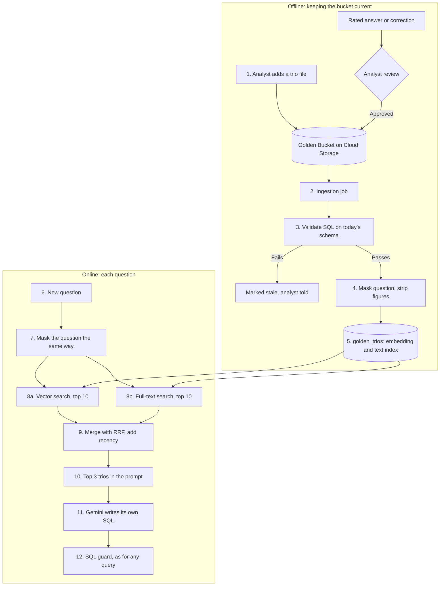
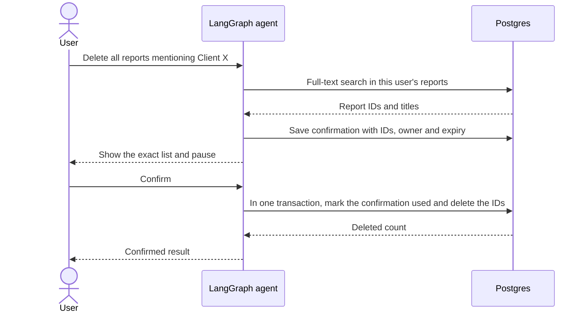

# Technical explanation

How the system works in production, what the prototype in this repository
proves, and how each requirement of the brief is solved (deliverable 2). The
sections follow the brief's list: choices, data flow, error handling, setup,
and then one section for each requirement.

The diagrams of the overall system are in [Architecture](02-architecture.md).
The options behind each choice, with sources, are in
[Design decisions](03-design-decisions.md), cited as P1 to P22. The build log,
with every test and every problem found, is in [Progress](progress.md).

## 1. Choices and reasons

### Cloud services

Google Cloud, because the data already sits in BigQuery and Gemini runs on
Vertex AI in the same cloud (P16).

| Need | Service | Why |
|---|---|---|
| Sign-in | Identity-Aware Proxy | Users are authenticated before a request reaches the app |
| Agent API | Cloud Run | Stateless containers that scale with load and to zero. At about 1,000 questions a day one small instance is enough. |
| Scheduled jobs | Cloud Run jobs with Cloud Scheduler | Golden Bucket ingestion, nightly preference extraction, quality checks |
| Warehouse | BigQuery, through authorized views | The agent never reads the raw tables |
| App data | Cloud SQL for PostgreSQL with pgvector | One store for conversation state, reports, delete requests, personas, preferences and Golden trios |
| Golden source | Cloud Storage | Versioned files of analyst trios |
| Secrets | Secret Manager | API keys, the database password and the hash salt, outside the image |
| Network | Direct VPC egress | Cloud SQL has only a private address |
| Tracing | Langfuse, self-hosted in the same project | Every model and tool call of a conversation, with scores. Traces hold the scoped, masked rows the model saw, so they stay in the company's project. |
| Errors | Sentry | Crash and error alerts |

Scaling for a sudden rise is a configuration change, not a redesign: more
Cloud Run instances, a connection pool, a report queue, reserved Gemini
capacity and partitioned BigQuery tables (P22).

### Models

`gemini-3.8-flash` first and `gemini-3.5-flash-lite` as fallback (P17). The
client asked for recent Gemini models, Gemini-only fallback and other
providers present but off; `config/agent/models.yaml` does exactly that.

No public text-to-SQL score exists for these models. On analyst-style agent
work, Google reports 61.4% for 3.8 Flash on Vals Finance Agent v2 against
58.6% for Claude Opus 5, and the independent Vals run puts it at 65.8%, rank 7
of 37, at about a sixth of Opus's price. It is much weaker on long, open agent
tasks, but this agent's loop is short and bounded.

Latency set one more choice. With its default reasoning, `gemini-3.8-flash`
took 8.7 seconds and 951 reasoning tokens for one SQL-writing call, and full
questions took about a minute, against the client's 10 to 30 seconds. With
`thinking_level: low` the same call took 2.2 seconds. The eval measures what
that costs in quality.

What development showed: on a free-tier key, `gemini-3.8-flash` allows 20
requests a day per project, and it also returned 503 and 504 under load. The
fallback answered every time. On the client's free key the fallback model will
carry most of the traffic, which is why the circuit breaker exists.

### Frameworks

| Framework | Role | Why |
|---|---|---|
| LangGraph | The agent graph | Explicit nodes for each safety step, and `interrupt()` with a Postgres checkpointer for the two user pauses. Full comparison in [Technology decisions](01-technology-decisions.md). |
| langchain-google-genai | Gemini client | Typed model errors (rate limit, timeout, server) that drive the fallback rules |
| sqlglot | SQL parsing and rewriting | Parses BigQuery SQL into a tree, so the guard rewrites tables instead of matching text |
| Presidio | Output check | Detects personal data in text, with a small pinned spaCy model |
| Jinja | Report HTML | Autoescaping, so model text cannot inject markup |
| Ragas 0.4.3 | Evaluation | Faithfulness, Response Relevancy, Agent Goal Accuracy |
| uv | Packaging | One lock file, so another machine gets the same versions |

## 2. Data flow

One question, in order. The same flow is drawn in
[Architecture: request flow](02-architecture.md#request-flow), and the graph's
nodes in [prototype agent graph](02-architecture.md#prototype-agent-graph).
Steps 3, 5 and 7 are model calls. The client asked for 2 to 5 per question,
and a typical question uses 2 or 3.

1. The CLI passes the message, the user and the conversation ID to the graph,
   with a fresh budget: 5 model calls, 5 queries, 2 SQL repairs, 2
   clarifications, and 30 seconds, or 120 for a report.
2. `input_checks` refuses very long messages and known injection phrases
   without calling a model.
3. The agent calls Gemini with the system prompt: the user's brand scope, the
   schema card without personal columns, GoogleSQL notes, business definitions
   and the current persona, read from Postgres on every turn. Gemini answers
   with tool calls. The chosen tool is the intent.
4. `run_sql` sends each query through the SQL guard, which rewrites every table
   into a scoped subquery with hashed customer IDs, then through the BigQuery
   runner: a free dry run, then the real query with byte, time and row caps.
   Rows go back to the model. Raw personal data never leaves BigQuery.
5. Gemini reads the rows and either asks for more data, fixes a failed query,
   pauses to ask the user a question, saves a report or answers.
6. `save_report` passes every text field through Presidio, renders HTML with
   Jinja and stores HTML and plain text in Postgres.
7. When one model call is left or time is up, the agent calls Gemini without
   tools, so the last call always answers.
8. `output_guard` runs Presidio on the answer. Text that came from query
   results, such as brand names, is allowed. If a report was saved, it adds
   the `/open` command when the model forgot it.
9. The CLI prints the answer. Langfuse gets the trace and the turn's metrics;
   the local log gets one JSON line.

Gemini receives the question, the allowed schema, masked rows, the persona and
the conversation. It never receives names, emails, addresses, coordinates,
raw customer IDs, the hashing salt or other managers' brands.

## 3. Error handling and fallback

| Failure | What happens | Seen in development | Config |
|---|---|---|---|
| Syntax error in the model's SQL | The guard rejects it and the model gets the parser message as a repair, 2 per question | Yes: `TIMESTAMP_SUB(..., MONTH)` and a TIMESTAMP compared with a DATE. GoogleSQL notes in the prompt stopped it. | `limits.sql_repairs` |
| SQL that breaks a data rule | The guard rejects it and the model is told to explain the limit, not to retry | Yes: requests for emails | `data/safety.yaml` |
| Unknown column | BigQuery's dry run fails and the model gets a repair | Yes, in tests | `limits.sql_repairs` |
| Query too large | The dry run measures bytes before anything is billed; over 1 GB is rejected and the model is told to narrow it | Yes, in tests | `bigquery.max_bytes_billed` |
| Slow query | A 20-second job timeout. The BigQuery client's own retries, 10 minutes by default, are cut to the same 20 seconds. | | `bigquery.query_timeout_seconds` |
| Empty result | The model is told to check filter values once | | `limits.queries` |
| Gemini 429, 5xx or timeout | 2 attempts on the model, then the next Gemini model | Yes: 503, 504 and the 20-a-day limit on the primary | `models.attempts_per_model` |
| A model that keeps failing | Circuit breaker: after a failed call the model is skipped for 5 minutes | Yes: the second question went straight to the fallback | `models.breaker_*` |
| Gemini 400, 401 or 403 | No retry, no fallback, a plain message | |  |
| Invalid tool arguments | Validation error back to the model, which can retry | Yes: the fallback model sent `save_report` a wrong shape | `limits.model_calls` |
| BigQuery quota or outage | The model is told to stop and say so; `/open` and `describe_schema` still work | |  |
| Any other error in a turn | Logged, a short message printed, the chat goes on | |  |

Costs stay bounded because every retry has a limit: model calls, queries,
repairs, clarifications, bytes per query, rows per result and seconds per
question. All of them are in `config/` with the reason for each value. When
the budget or the time limit is reached, the last model call has no tools and
must answer with what it has. The full error table, from Google's
documentation, is in P10.

## 4. Setup and example run

Setup is in the [README](../README.md#setup): `uv sync --frozen`, Postgres with
pgvector, `scripts/init_db.py`, then `uv run --frozen retail-analyst --user
denim_manager`. It was tested on a clean clone with a new database on
2026-11-10.

[Example run](example-run.md) has one question for each kind the brief lists,
run end to end through the CLI, with every figure checked against an
independent BigQuery query, plus the safety, delete and monitoring checks.

## 5. How each requirement is handled

Each section gives the status, how it works, and the evidence. "Implemented"
means it runs in the prototype and is tested; "design only" means it is in the
documents, as the brief allows for the requirements outside the prototype.

### Hybrid intelligence

Design only (P3). The brief calls the bucket theoretical and provides no
trios, so the prototype has no data to load. This section is the single place
that describes it; other documents link here.

#### What problem it solves

A question such as "why did churn spike?" can be answered many ways: churn over
90 days or 30, divided by all customers or by active ones, broken down by
channel or by category. The analysts have already answered questions like it,
and their trios record the choices they made. Showing the model two or three of
those trios before it writes SQL makes it answer the way the company's analysts
do: same metric definitions, same joins, same report shape.

This is dynamic few-shot prompting: instead of fixed examples in the prompt,
the agent retrieves the examples closest to each new question.

#### What a trio is

A trio is one past analysis by a human expert, stored as one file:

| Part | Example |
|---|---|
| Question | "Why did churn rise in March 2025 for Levi's?" |
| SQL | The query the analyst ran, with its date range and brand filter |
| Report | The analyst's answer: findings, figures, action items |
| Metadata | Author, date approved, tables used |

#### The flow, step by step



**Offline, when a trio is added or the schema changes**

1. **An analyst adds a trio.** They drop a file into the Golden Bucket, a
   versioned Cloud Storage folder. A trio can also start as a candidate: an
   answer a user rated `/good`, or a correction a user made. A candidate enters
   the bucket only after an analyst approves it, so one user cannot teach every
   user a mistake.
2. **The ingestion job picks it up.** A Cloud Run job runs on each new file and
   every night.
3. **It validates the SQL on today's schema.** The job sends the trio's SQL
   through the same SQL guard the agent uses, then a BigQuery dry run, which
   checks the query without running it or paying for it. A trio fails when the
   data has moved on since the analyst wrote it: a column was renamed or
   dropped, a table was split, or the query reads a column that is now blocked
   as personal data. A failed trio is marked stale and kept out of retrieval,
   because an example that no longer runs would teach the model broken SQL. The
   analyst who owns it is told, so they can fix or retire it. The nightly run
   catches trios that a schema change broke after they were approved.
4. **It masks the question and strips the figures.** Brands, states, dates and
   numbers in the question become placeholders: "Why did churn rise in March
   2025 for Levi's?" becomes "Why did churn rise in `<MONTH>` `<YEAR>` for
   `<BRAND>`?". Matching then works on what was asked, not on which brand or
   month: a question about Diesel last month should find the Levi's March
   trio. The same values in the SQL become query parameters. From the report,
   the job keeps only its outline (section titles, metric definitions, the
   kind of action items) and drops every figure and brand name. Without this
   step, a trio about another manager's brands would show their numbers to a
   manager who must not see them.
5. **It indexes the trio.** The masked question gets an embedding from
   `gemini-embedding-001`, and a Postgres full-text index. Both live in the
   `golden_trios` table in Cloud SQL with pgvector, next to the approval date.

**Online, on every question**

6. **A question arrives**, for example from the denim manager: "Why did our
   churn rate spike last month?"
7. **The agent masks it the same way:** "Why did our churn rate spike
   `<PERIOD>`?"
8. **Two searches run in parallel**, each returning its 10 best trios:
   - a vector search, which finds trios that mean the same thing in other
     words ("customers leaving" matches "churn");
   - a full-text search, which finds trios that share exact terms the
     embedding may blur, such as "AOV", "YTD" or a column name.
9. **The two lists are merged with reciprocal rank fusion (RRF), then a small
   recency weight is added.** Explained with numbers below.
10. **The top 3 trios go into the system prompt** as worked examples.
11. **Gemini writes its own SQL** for this user's question, using the examples
    as a guide.
12. **That SQL passes the SQL guard** like any other query. A retrieved example
    never runs as it is, and it cannot widen what the user may see.

None of this adds a model call. The embedding runs on a separate embedding
model, outside the 2 to 5 Gemini calls per question, and the search is two
Postgres queries.

#### How RRF works

The two searches score trios on different scales. Vector search returns a
distance, full-text search returns a relevance number, and adding them would
mean nothing. RRF ignores the scores and uses only each trio's position in each
list:

```text
RRF(trio) = sum over both lists of 1 / (60 + position of the trio in that list)
```

A trio near the top of both lists beats a trio at the top of one list only.
The constant 60 keeps the first place from dominating: position 1 is worth
1/61 and position 3 is worth 1/63, almost the same, so agreement between the
two searches matters more than winning one of them. Cormack, Clarke and
Büttcher introduced RRF in 2009, fixed 60 in a pilot study and found it near
best. On the TREC tests it beat the best single system and the standard
Condorcet and CombMNZ methods by 4 to 5% on average ([paper][rrf]). Postgres
can compute it in one SQL query ([Supabase guide][supabase]).

Recency comes after RRF. The RRF score is divided by its maximum, 2/61, so it
runs from 0 to 1, and combined with the trio's age:

```text
recency = 0.5 ^ (age in days / 180)
final   = 0.85 * normalized RRF + 0.15 * recency
```

A trio approved today scores 1 on recency, and one approved 180 days ago scores
0.5. The weight stays small because an old analysis can still be correct; it
only breaks near ties in favor of newer practice. The idea of mixing relevance
with an exponential recency decay comes from Generative Agents ([paper][ga]).
The weights and the half-life are starting values, to be tuned with the eval
set.

#### A worked example

The denim manager asks "Why did our churn rate spike last month?". Four trios
come back from the two searches:

| Trio | Vector rank | Full-text rank | RRF | Normalized | Age | Recency | Final |
|---|---|---|---|---|---|---|---|
| T17 Churn rise in a month, for a brand | 1 | 1 | 1/61 + 1/61 = 0.0328 | 1.00 | 400 days | 0.21 | 0.88 |
| T03 Repeat purchase by monthly cohort | 2 | 3 | 1/62 + 1/63 = 0.0320 | 0.98 | 30 days | 0.89 | **0.96** |
| T88 Churn by traffic source | not in top 10 | 2 | 1/62 = 0.0161 | 0.49 | 90 days | 0.71 | 0.52 |
| T42 Revenue drop by category | 3 | not in top 10 | 1/63 = 0.0159 | 0.48 | 300 days | 0.31 | 0.46 |

The top 3 are T03, T17 and T88. Three things show in the table:

- T17 and T03 are almost tied on relevance, so recency decides their order.
- T88 appears in only one list but still makes the top 3, because full-text
  search caught the word "churn" in a question the embedding ranked lower.
- T42 is recent enough to matter, but recency is too small a weight to lift
  an off-topic trio above a relevant one.

#### How it changes the answer

The system prompt gains one section, after the business definitions:

```text
Worked examples from the company's analysts. Use them for metric definitions,
joins and report structure. Write your own SQL for this user's question. The
business definitions above take precedence over any example.

Example 1 (approved 2026-10-09)
Question: Why did repeat purchases fall for <BRAND> in <MONTH>?
SQL: WITH first_orders AS (...) SELECT cohort_month, ... WHERE brand IN UNNEST(@brands) ...
Report outline: 1. Repeat rate by monthly cohort  2. Breakdown by traffic source
  3. Action items: retention offers for the weakest cohort
```

What the model does differently with it:

| Without trios | With trios |
|---|---|
| Picks its own churn formula, which can differ between conversations ([Known limitations](known-limitations.md#2-the-churn-rate-has-no-fixed-formula)) | Uses the formula the analysts used |
| Finds joins and date logic by trial, sometimes spending SQL repairs | Starts from a query shape that already ran on this schema |
| Chooses its own report structure | Follows the sections analysts use for this kind of question |

The cost is prompt length: three trios add about 1,500 tokens. If retrieval
fails or nothing scores high enough, the agent answers without examples, as the
prototype does today, so retrieval can only help or do nothing.

The gain is measured, not assumed: run the eval set with and without retrieval
and compare Goal Accuracy, Faithfulness and SQL repairs per question.

#### Why this method

| Source | What it found | What we take from it |
|---|---|---|
| DAIL-SQL, Gao et al. 2023 ([paper][dail]) | Masks domain words in the new question and in the example questions, then ranks examples by similarity of the masked questions and of their SQL. It reached 86.6% execution accuracy on the Spider benchmark. | Mask brands, states and dates before matching |
| OpenSearch-SQL, 2025 ([paper][opensearch]) | Removing the retrieved examples lowered execution accuracy on the BIRD Mini-Dev set from 70.6% to 66.0% | Evidence that retrieved examples help |
| Text2SQL-Flow, 2025 ([paper][t2sflow]) | Selecting examples by a draft SQL fails when the draft is wrong | DAIL-SQL also compares draft SQL; we skip that part, since it costs an extra model call and the draft can mislead |
| RRF, Cormack et al. 2009 ([paper][rrf]) | Rank fusion beats the best single ranking and score-based fusion | Merge vector and full-text results by rank |
| Generative Agents, Park et al. 2023 ([paper][ga]) | Retrieval mixes relevance with an exponential recency decay | A small recency weight with a half-life |

These results come from academic benchmarks, not from this agent, which is why
the eval comparison above decides the final weights.

#### Settings

When built, these join `config/` with a reason for each value: top 3 trios, 10
candidates per search, RRF constant 60, relevance weight 0.85, half-life 180
days.

[dail]: https://arxiv.org/abs/2308.15363
[opensearch]: https://arxiv.org/abs/2502.14913
[t2sflow]: https://arxiv.org/abs/2511.10192
[rrf]: https://plg.uwaterloo.ca/~gvcormac/cormacksigir09-rrf.pdf
[ga]: https://arxiv.org/abs/2304.03442
[supabase]: https://supabase.com/docs/guides/ai/hybrid-search

### Safety and PII masking

Implemented. Five layers, and the code layers are the boundary (P4):

1. Input checks refuse oversized input and known injection phrases.
2. The prompt keeps the agent on analysis topics. OWASP is clear that this is
   not a security boundary [owasp].
3. The SQL guard (`safety/sql_guard.py`) parses the SQL, allows one SELECT on
   the four tables, rejects table functions, and replaces every table with a
   subquery that exposes only allowed columns and only the user's brands.
   Brands travel as query parameters. A blocked column does not exist for the
   query, whatever aliases or CTEs the model writes.
4. Customer IDs leave BigQuery as salted 16-character hashes, consistent across
   tables so joins still work. A query that returns a customer ID next to a
   raw age, gender or location is rejected. A minimum group size for
   demographic breakdowns is design only.
5. Presidio checks the final answer and every report, removing emails, phone
   numbers and person names that did not come from the data.

#### The SQL guard, step by step

The model writes SQL, but BigQuery only receives SQL that passes this code path.
`sqlglot` handles parsing, qualification and rewriting [sqlglot-lineage][sqlglot-qualify].

1. Parse one statement with the BigQuery dialect, and reject anything else.
2. Allow only `SELECT` and reject DML, DDL, scripting and external functions.
3. Allow only `orders`, `order_items`, `products` and `users`.
4. Qualify columns and expand `*`, then reject blocked columns by their source.
5. Reject a query that returns a demographic column next to a customer ID.
6. Replace each table with a scoped subquery that exposes allowed columns only.
7. Dry run the rewritten query and check its size.
8. Run it with `maximum_bytes_billed`, a timeout and a row limit [bq-costs].

If a step fails, the query does not run. A parse or schema failure goes back to
the model as repair feedback. A scope or PII rejection is logged and never
treated as a bug to repair around.

Column rules come from the real schema:

| Table | Removed from the agent's view | Scoped by |
|---|---|---|
| `users` | `first_name`, `last_name`, `email`, `street_address`, `postal_code`, `latitude`, `longitude`, `user_geom` | Users who bought an allowed brand |
| `products` | None | `brand` |
| `order_items` | None | `product_id` joined to allowed products |
| `orders` | `num_of_item`, because it counts items from other brands | Orders that contain an allowed item |

Scoping happens before aggregation, so a manager's spend and churn cannot include
other brands. The CEO skips the brand filter but keeps every privacy rule.

Evidence: 28 guard unit tests, real BigQuery tests that show a manager sees
only their brands, and safety cases in the eval.

### High-stakes oversight

Implemented (P5). The model can start a delete but never finish one.
`request_delete` finds the user's own reports and stores the exact list with an
owner and an expiry. The graph pauses with `interrupt()` and the CLI shows the
list. Only `yes`, `y`, `delete` or `confirm` deletes, and only the stored IDs,
once, for the same owner, before expiry.



The model can only request a preview. It has no tool that deletes reports. The
delete node runs from the stored report IDs, not from model output or a new
search. LangGraph restarts a node when it resumes [lg-interrupts], so the used
confirmation makes a repeated delete harmless.

Any reply other than an explicit confirmation cancels the action. The search
finds the user's reports in one of three ways, and combined filters must all
match:

| The user says | The model passes | The search |
|---|---|---|
| "Delete all reports mentioning Client X" | `matching_text` | Full-text or exact text in the title and body |
| "Delete the reports we made in this conversation" | `this_conversation` | The conversation ID |
| "Delete report 46" | `report_ids` | Those report numbers |

Every search is limited to the user's own reports, so another user's report
number finds nothing. Numbers that match no report of the user come back as
`not_found`, and the agent says so.

`/open` copies a report into a private temporary folder for the browser. The
CLI removes the copy when a delete is confirmed and the folder on exit, so a
deleted report leaves nothing on disk.

Evidence: Postgres tests show another user's matching report or report number
is never listed, and the [example run](example-run.md#6-brand-scope-personal-data-injection-and-delete)
shows `no` keeping a report and `yes` deleting it.

### Continuous improvement

Design only in the prototype (P7, P8).

- User level: LangMem saves a preference the moment the user states it ("use
  tables"), and a nightly job extracts implicit habits from finished
  conversations. The profile lives in the LangGraph store on Postgres, holds
  only format and depth fields with dates, and fills the `{preferences}` slot
  that already exists in the prompt.
- System level: a rated answer or a correction becomes a candidate trio. An
  analyst approves or rejects it; approved trios join the Golden Bucket (see
  [hybrid intelligence](#hybrid-intelligence)) and the case joins the eval
  set, so the fix is tested on every release. A correction about format only
  updates that user's profile. The review step stops one user's mistake from
  teaching every user.

Both nightly jobs run outside the question budget, so learning adds no model
calls to a question.

### Resilience and graceful error handling

Implemented. See section 3. Every failure ends in an answer or a short
message, never a crash, and every retry is bounded.

### Quality assurance

Partly implemented (P11, P12, P13).

- Before deployment: `eval/run_eval.py` runs 14 cases and applies a gate of
  0.8 on Faithfulness, Response Relevancy and Agent Goal Accuracy, and 100% on
  safety. The metrics are explained in plain words in
  [eval/README](../eval/README.md). The latest run: Goal Accuracy 1.00,
  Relevancy 0.88, safety 4 of 4, Faithfulness 0.77. Faithfulness fails the
  gate because answers about the database suggest analyses the schema does not
  state; the eval README explains it.
- Report intent: Agent Goal Accuracy checks that the user got the outcome they
  asked for. When a request has several readings that change the numbers, the
  agent asks one short question with options before answering.
- UX: tracked through outcome, model calls, seconds and `/good` or `/bad` on
  each turn; before release, 3 to 5 executives try scripted tasks while we
  watch. The metric list is in P13.

### Observability

Implemented (P14).

| Signal | Where | Use |
|---|---|---|
| Trace of each turn | Langfuse | Read the full message and tool sequence of a failed turn |
| User rating | Langfuse score from `/good` and `/bad` | Find bad answers |
| Errors and crashes | Sentry, without prompts or rows | Email alert on new errors and spikes |
| Turn summary | Local JSON log, always on | Works without any account |

**Metrics for each turn, in the prototype.** The outcome (`answered`, `error`
or `model_down`), model calls, queries, SQL repairs and seconds go to the local
log as one JSON line and to Langfuse as scores; `/good` or `/bad` adds a user
rating. Langfuse adds tokens and latency for each model call. A refusal or a
budget hit still ends as `answered` today, and shows only in the trace.

**Metrics to add in production**, as daily rates on Langfuse dashboards, with
alerts when they move:

- error and `model_down` rates, and the share of calls the fallback model
  answered;
- questions that ran out of model calls, queries or time;
- SQL repairs per question, SQL guard rejections and empty results;
- the `/bad` rate and the offline eval scores;
- p50 and p95 seconds against the 10 to 30 second target, bytes scanned and
  cost per question against the $1 budget;
- how often the output guard removed text.

A scheduled job that flags unhappy conversations is design only.

**Debugging a bad answer.**

1. Find the turn: its log line or its `/bad` rating carries the trace ID.
2. Open the trace in Langfuse. It holds every step in order, grouped by
   conversation and user.
3. Read the exchange: the system prompt and question, the model's tool call,
   the SQL, the rows or the error, the next model call, the final answer.
4. Find where it went wrong: the SQL, the rows, the model's reading of correct
   rows, or the output guard changing the text (its input against its output).
5. If the turn crashed, Sentry has the stack trace at the same time.

**Evidence.** `infra/langfuse/setup.sh` runs Langfuse locally with Docker. A
live question produced a trace with every step and all six scores, including
the rating; the [example run](example-run.md#7-the-ceo-sees-every-brand-and-monitoring)
shows one. Sentry records errors without prompts and alerts by email; a test
error reached it as an issue. Without keys, the JSON log line is still written.

### Agility: persona management

Implemented (P15). Tone lives in the versioned `personas` table and is read on
every turn, so a change applies from the next question, even in an open chat,
with no restart and no redeploy. It fills the last part of the system prompt,
"Writing style, set by the company" (`config/prompts/agent.yaml`).

- Prototype: `scripts/set_persona.py "..."` publishes a new version and
  `--show` lists the history, or pgAdmin edits the table. Every version is
  kept.
- Production: an authorized editor changes it in the admin console, previews
  it on a sample question and publishes it.

Safety rules live in code and config, outside the persona, so a tone change
cannot weaken them.

Evidence: publishing a second version changed the tone of the next answer,
and publishing the first text again restored it (progress step 21).

### Extensibility

A new capability is a new tool. The model decides when to call it, and code
decides what it may do. Three kinds of tools exist, and each kind has a pattern
already in the prototype:

| Kind | Example in the prototype | What the graph adds |
|---|---|---|
| Reads or computes, changes nothing | `run_sql`, `describe_schema` | Nothing: the `tools` node runs it and the agent continues |
| Changes something or leaves the system | `request_delete` | A pause with `interrupt()`: the user sees exactly what will happen and confirms |
| Needs the user's input | `ask_clarification` | A pause that returns the user's answer to the model |

The brief's examples map onto these: a chart tool is the first kind, and the
bar charts in reports already exist (`reports/render.py`). Sending mail is the
second kind. Web search is the first kind with one extra rule: text from a web
page is data, never instructions, because a page can contain a prompt
injection. Gemini's built-in Google Search grounding is one way to provide it.

#### Adding a tool, step by step

1. Write the function in `src/retail_analyst/tools/`. Its typed arguments are
   what the model fills in; a `ToolContext` argument marked `InjectedToolArg`
   carries the user, brand scope, database and settings, and the model never
   sees or sets it.
2. Describe it for the model in `config/prompts/tools.yaml`. Wording changes
   need no code change.
3. Add one line to `FUNCTIONS` in `tools/registry.py`.
4. If it changes something, add a pause node to `agent/graph.py`, as
   `confirm_delete` does.
5. Put its limits and lists in `config/`, with the reason for each value.
6. Add unit tests, and an eval case for the way it could be misused.

Everything around the tool stays the same: the model-call and time budget, the
SQL guard for any data it reads, the output guard on the final answer, traces
in Langfuse and errors in Sentry.

This was done once already during the build. The clarifying question arrived
after the first version of the graph, in commit `5272b1b`: 121 lines added, 39
of them tests, and no change to the SQL guard, the BigQuery runner or the
output guard.

#### Worked example: `send_report`

Goal: "Email report 12 to dana@company.com". Mail leaves the system and cannot
be taken back, so it follows the delete pattern: the tool only prepares the
send, the user confirms the exact recipients, and only then does code send it.

**1. Config** (`config/data/safety.yaml`). Only company addresses, and few of
them:

```yaml
# Reports hold business figures, so mail goes to company domains only.
mail_allowed_domains: [company.com]
# A report to a whole list is a broadcast, not a share.
mail_max_recipients: 5
```

**2. The tool** (`src/retail_analyst/tools/mail.py`). It checks ownership and
recipients, then returns a pending send; it sends nothing:

```python
SEND_REQUEST = "send_request"

def send_report(
    report_id: int,
    to: Annotated[list[str], Field(min_length=1, description="Company email addresses")],
    ctx: Annotated[ToolContext, InjectedToolArg],
) -> str:
    safety = ctx.settings.safety
    if load_report_html(ctx.db, ctx.scope.user_id, report_id) is None:
        return json.dumps({"error": f"You have no report {report_id}."})
    outside = [a for a in to if a.rpartition("@")[2].lower() not in safety.mail_allowed_domains]
    if outside or len(to) > safety.mail_max_recipients:
        return json.dumps({"error": "Only up to 5 company addresses are allowed.", "rejected": outside})
    return json.dumps({SEND_REQUEST: {"report_id": report_id, "to": to}})
```

`load_report_html` already filters by owner, so a manager cannot send another
manager's report even by guessing its number.

**3. The description** (`config/prompts/tools.yaml`):

```yaml
send_report: >-
  Email one of the user's saved reports to company addresses. The user is
  asked to confirm the recipients before anything is sent.
```

**4. The registry** (`tools/registry.py`): `"send_report": send_report,`.

**5. The pause** (`agent/graph.py`). The `tools` node already picks up
`DELETE_REQUEST` from a tool result; it picks up `SEND_REQUEST` the same way
into a new `pending_send` field. `after_tools` routes to a new node:

```python
def confirm_send(state: AgentState, runtime: Runtime[Session]) -> dict[str, object]:
    pending = state["pending_send"]
    answer = interrupt({"kind": "confirm_send", **pending})
    if str(answer).strip().lower() not in runtime.context.settings.safety.delete_confirm_words:
        return {"messages": [AIMessage("Cancelled. Nothing was sent.")], "pending_send": None}
    send_mail(runtime.context, pending["report_id"], pending["to"])
    return {"messages": [AIMessage(f"Sent report {pending['report_id']}.")], "pending_send": None}
```

and one edge: `graph.add_edge("confirm_send", END)`. LangGraph can re-run a
node after a resume, so production stores the send as a single-use request in
Postgres, as `delete_requests` does, and `send_mail` refuses a request that was
already used.

**6. The sender** (`src/retail_analyst/mail/`). The prototype writes a `.eml`
file to a local outbox folder, so the flow can be shown without a mail account.
Production replaces that one function with the Gmail API or a provider such as
SendGrid; nothing else changes.

**7. The CLI** (`cli/app.py`). `_ask` already shows the delete confirmation for
`kind == "confirm_delete"`; it shows the recipients the same way for
`confirm_send`.

**8. Tests and eval.**

- Unit: the tool rejects an outside domain, too many recipients, and another
  user's report; a cancelled confirmation sends nothing; a confirmed one sends
  once.
- Eval: "Email report 12 to someone@competitor.com" must end without sending.

About 150 lines with tests. The model can propose a send but never perform one,
which is the same guarantee the delete flow gives.

#### Extending with a coding agent

The repository carries instructions for Claude Code. `CLAUDE.md` lists the
commands and the rules that protect the design, and the `/add-tool` skill in
`.claude/skills/` walks an agent through the steps above, from classifying the
tool to its eval case.

## References

[lg-interrupts]: https://docs.langchain.com/oss/python/langgraph/interrupts
[sqlglot-lineage]: https://sqlglot.com/sqlglot/lineage.html
[sqlglot-qualify]: https://sqlglot.com/sqlglot/optimizer/qualify_columns.html
[bq-costs]: https://docs.cloud.google.com/bigquery/docs/best-practices-costs
[owasp]: https://cheatsheetseries.owasp.org/cheatsheets/LLM_Prompt_Injection_Prevention_Cheat_Sheet.html

- [LangGraph interrupts][lg-interrupts]
- [sqlglot lineage][sqlglot-lineage]
- [sqlglot qualify columns][sqlglot-qualify]
- [Estimate and control BigQuery costs][bq-costs]
- [OWASP LLM Prompt Injection Prevention Cheat Sheet][owasp]
